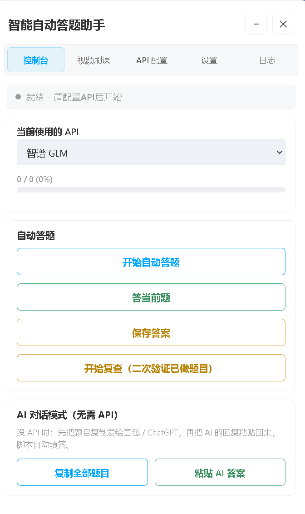
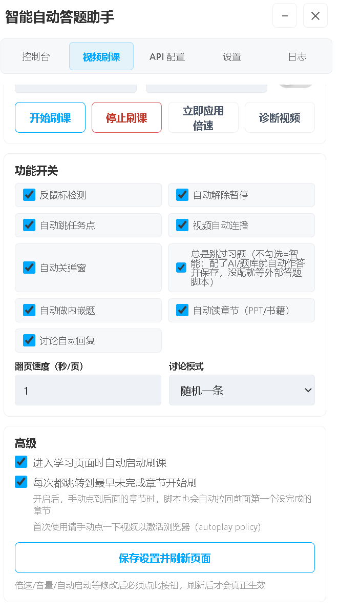
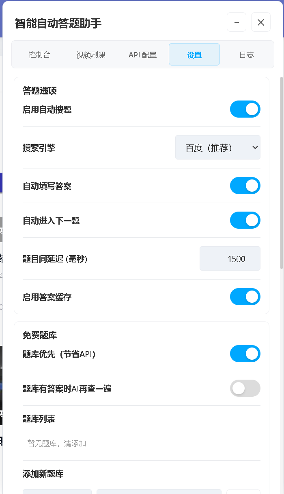
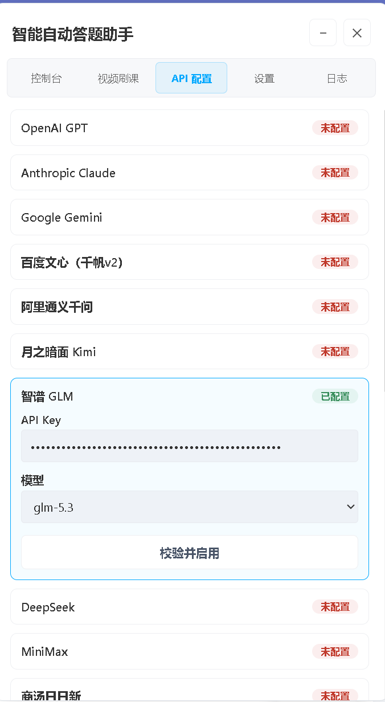
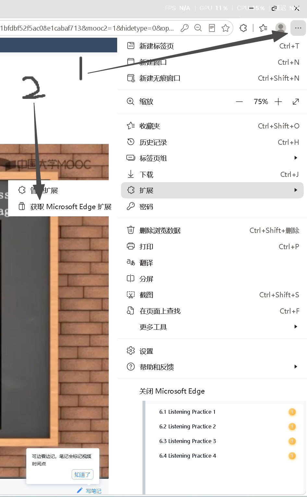
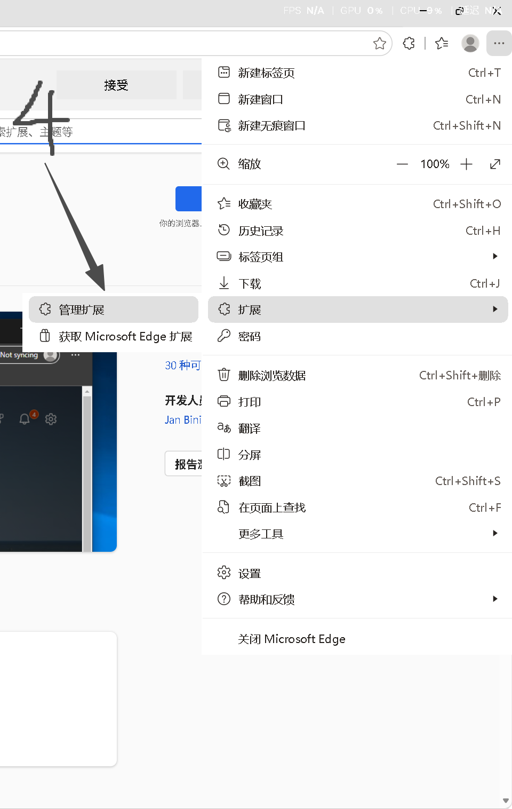
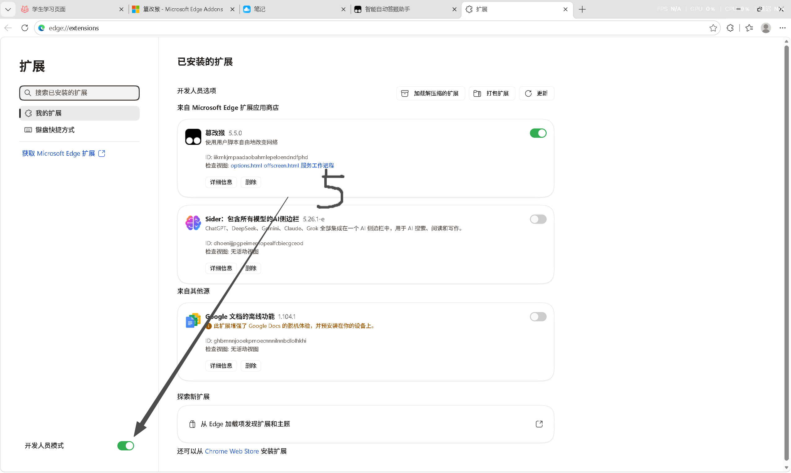
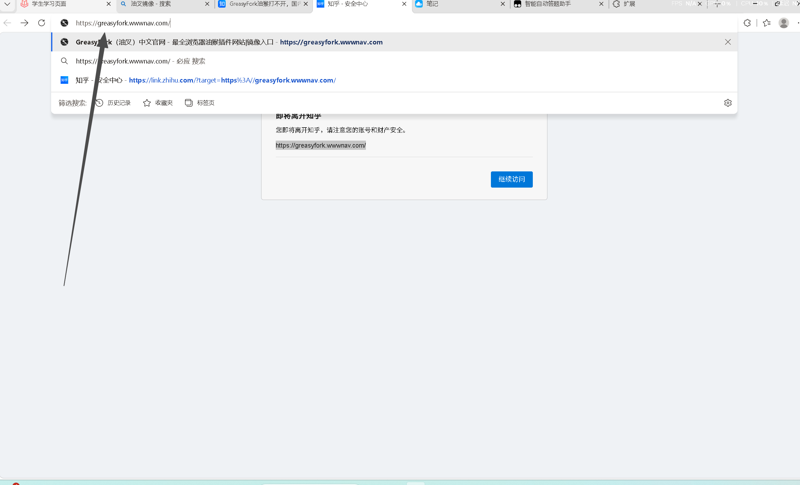
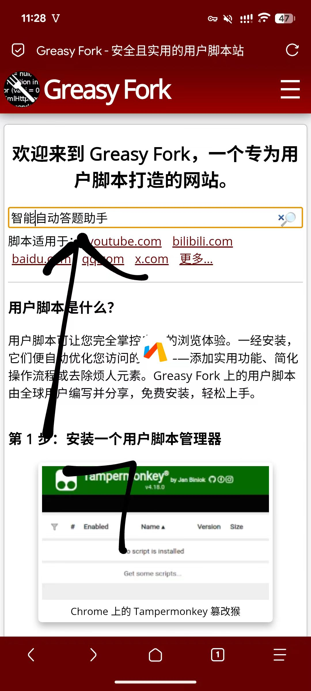
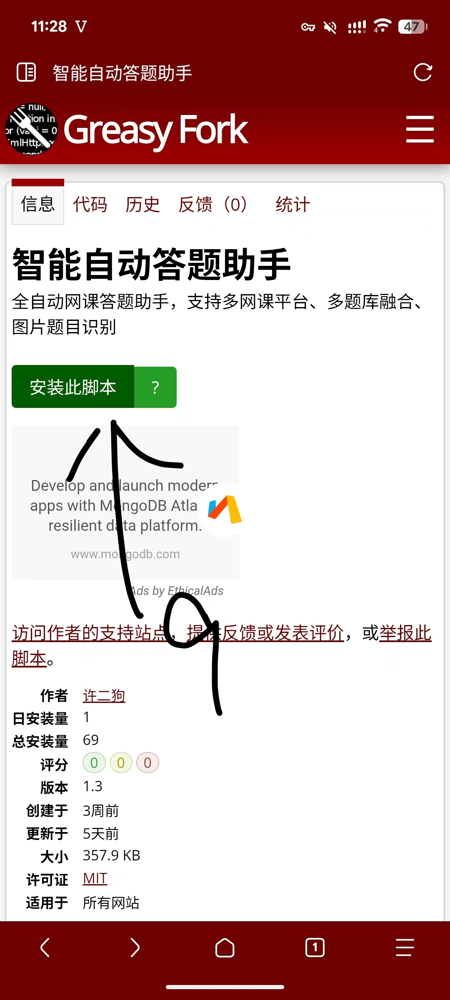

# 学习通自动答题脚本 · 自动刷课脚本（智能自动答题助手）

> **超星学习通 / Chaoxing / Xuexitong 自动刷课脚本 + 自动答题脚本**，油猴（Tampermonkey）用户脚本。
> 视频倍速自动刷课、章节任务点自动完成、作业与考试自动答题，内置 13 家 AI 大模型自动作答，并支持自建题库融合。
>
> **搜索关键词**：学习通脚本、超星脚本、智慧树脚本、学习通自动答题、超星自动答题、学习通自动刷课、超星自动刷课、自动刷课脚本、自动答题脚本、网课脚本、油猴脚本、userscript、Tampermonkey、GreasyFork、chaoxing、xuexitong、exam helper、homework helper、video brush

本仓库包含两部分：

- **`超新学习通答题脚本.js`** — 智能自动答题助手（油猴用户脚本，**v2.9**）
- **`刷课题库/`** — 配套的远程题库服务，为脚本提供统一答题查询接口
- **`docs/`** — 更新与修复报告、多视频顺序播放的复现测试台
- **`学习通解除复制限制.user.js`** — 解除作业/考试页面的复制限制（独立脚本，不参与答题）

---

## 一、智能自动答题助手（用户脚本）

一个油猴用户脚本，运行在浏览器中，用于自动完成在线网课的题目和视频学习。

### 主要功能

**答题能力**

1. 自动检测网页中的题目，支持单选题、多选题、判断题、填空题、简答题
2. 支持接入 13 家 AI 大模型自动作答：OpenAI GPT、Anthropic Claude、Google Gemini、百度文心一言、阿里通义千问、月之暗面 Kimi、智谱 GLM、深度求索 DeepSeek、MiniMax、商汤日日新、小米 MiMo、字节豆包，也支持自定义 API 接入
3. 模型列表已对齐各家 2026-10 官方最新版（如 `gpt-6.1-sol` / `claude-sonnet-5-5` / `gemini-4-argon` / `deepseek-v4.1-flash` / `mimo-v2.6-pro` / `MiniMax-M3.1-Flash` 等）
4. 支持通过 Bing、Google、百度 三个搜索引擎搜题，AI 答不上来时用搜题结果兜底
5. 支持自定义题库，可添加多个题库进行融合答题，每个题库支持自定义请求方法、请求头、请求体、响应解析脚本
6. 支持答题缓存，答过的题目会缓存下来，再次遇到相同题目直接用缓存答案
7. 支持双 API 对比模式，启用后调用两个 AI 同步答题，答案一致才填写，提升准确率
8. 支持图片题目识别（跨域题图也能取到，不会整题跳过）
9. 支持自动填写答案并自动切换到下一题，中间过程无需人工干预
10. 支持题目类型过滤，可以只做某种类型的题目
11. 支持多种答题起始模式：从头开始 / 从未做的题目开始 / 继续上次进度

**刷课能力**

12. 进入视频学习页面后自动完成视频观看：视频倍速播放、音量调节、鼠标离开视频时不暂停、自动解除暂停状态、视频结束后自动连播下一个、检测到弹窗时自动关闭
13. **同一章节多个视频时严格按顺序播放**（第一个播完播第二个，再第三个），不会在多个视频之间来回抢播、也不会漏播
14. 支持视频内嵌题目的自动作答，学习通视频播放过程中弹出的选择题会自动识别并填写
15. 支持自动读章节功能，PPT、书籍、长文本等需要翻页阅读的任务点可自动翻页完成
16. 支持自动讨论，章节末的讨论题可自动发表回复，支持随机回复 / 第一条 / 出现最多 / 点赞最多等模式
17. 支持一键跳到最早未完成章节 / 跳下一个未完成章节，并做防抖避免来回跳触发人机验证

**通用**

18. 支持内置网站白名单，覆盖超星学习通、智慧树、雨课堂、中国大学 MOOC、职教云、智慧职教、高校邦、对分易等常见网课平台，也支持自定义添加
19. 支持可拖拽的控制面板，悬浮在网页右上角，可拖到任意位置
20. 支持运行日志实时显示，可查看每一道题的答题过程和结果

### 界面预览






### 安装与使用（图文教程）

#### 第 1 步：安装油猴插件（Tampermonkey）

打开 Edge 浏览器，点击右上角头像 / 齿轮 →「扩展」→「获取 Microsoft Edge 扩展」：



在扩展商店搜索框输入 **篡改猴（Tampermonkey）**，点击第一个结果（**不要选测试版**）：


点击扩展的「管理扩展」，确认篡改猴已启用：



进入 `edge://extensions` 管理页，打开「开发人员模式」，确认篡改猴的「服务工作进程」正在运行：



> 推荐在 **Edge 官方扩展商店** 安装。若商店打不开，也可访问篡改猴镜像站：https://www.tampermonkey.net/
> 使用 Greasy Fork 时若遇到跳转安全提示，点击「继续访问」即可（见下图）：



#### 第 2 步：安装本脚本

打开 Greasy Fork，搜索 **智能自动答题助手**（或直接访问脚本页面）：



找到「智能自动答题助手」脚本（作者：许二狗），点击进入：


点击绿色的 **「安装此脚本」** 按钮，在弹出的确认框中点击「安装」即可完成：



> **备选安装方式**：直接从本仓库复制源码安装——
> 打开篡改猴「管理面板」→「添加新脚本」，将下方文件全文复制粘贴进去并保存：
> ```text
> 超新学习通答题脚本.js
> ```
>
> 也可点此直链下载（GitHub Raw）：<https://raw.githubusercontent.com/xu20060420fan-cell/chaoxing-auto-answer-script/main/%E8%B6%85%E6%96%B0%E5%AD%A6%E4%B9%A0%E9%80%9A%E7%AD%94%E9%A2%98%E8%84%9A%E6%9C%AC.js>

#### 第 3 步：使用

1. 打开任意一个支持的网课平台页面，页面右上角会出现本脚本的控制面板
2. 在面板的设置页面中填入对应 AI 平台的 API Key，也可以添加自定义题库的 URL
3. 根据需要调整各种开关，例如是否自动填写、是否自动下一题、答题延迟时间等
4. 切换到答题页面，点击开始按钮，脚本会自动开始检测题目并完成作答
5. 如果需要刷课功能，可以在设置中开启刷课开关，进入视频学习页面后脚本会自动开始
6. 如果需要自动讨论，可以在设置中开启讨论开关，脚本会在遇到讨论题时自动发表回复

### 支持的网课平台

超星学习通、智慧树、雨课堂、中国大学 MOOC、职教云、智慧职教、高校邦、对分易、好大学在线、网易云课堂、中国通识课 等大部分使用标准题库结构的网课平台。

### 参考的开源项目

- OCS 网课助手 — 参考刷课逻辑、视频事件处理、章节判断
- 万能全平台自动答题脚本 — 参考题库融合架构、答案解析流程、AI 模型适配

### 参考的 AI 大模型项目

OpenAI GPT / Anthropic Claude / Google Gemini / 百度文心一言 / 阿里通义千问 / 月之暗面 Kimi / 智谱 GLM / 深度求索 DeepSeek / MiniMax / 商汤日日新 / 小米 MiMo / 字节豆包

**作者**：xu20060420fan-cell　**版本**：2.9

---

## 二、最近更新（v2.9 · 2026-10-23 实机复核）

本次在学习通真实账号上逐环节复核了「刷课」与「答题」两条链路，修复了一批会导致**多个视频之间轮流重播、漏视频**以及**答题被跳过**的问题：

| 类别 | 修复内容 |
|---|---|
| 多视频顺序播放 | 引入**播放队列 + 只进不退的指针**，平台重建卡片 DOM 时按视频地址对齐指针，不会跳回第一个视频 |
| 目标视频互斥 | 顶层标记"当前唯一要保护的视频"，各播放器 iframe 里的 worker 只恢复它、`pause` 重写只拦它，其余视频一律放行给平台 → 不再互相抢播 |
| 任务点精确识别 | 用视频地址里的 objectid 与 `attachments[].property.objectid` 精确匹配，准确判断某个任务点是否已完成 → 不再重播已看完的视频 |
| 目录页计数 | 适配学习通新版章节目录页的未完成任务点数选择器 |
| 选项去重 | 超星作业里 `<li>` 与 `<i>A、</i>` 会被重复收集，导致给 AI 的选项表变成 A/A/B/B —— 已按字母去重并改用可点击容器 |
| AI 调用稳定性 | 自定义 API 刷新后丢失 `model` 导致全部 400；请求无超时导致流水线永久挂死；跨域图片题 100% 被跳过；双 API 答案缓存写穿；思考型模型参数被拒 —— 全部修复 |
| 模型列表 | 13 家模型名对齐 2026-10 官方最新版 |

详见 [`docs/脚本更新与修复报告.md`](docs/脚本更新与修复报告.md)。

### 多视频顺序播放的复现测试台

`docs/多视频顺序播放测试台.mjs` 会**从脚本源码中原样抽取**做决策的函数，在复刻真实学习通 DOM 的时序模拟里跑，打印每一轮选了哪个视频：

```bash
node docs/多视频顺序播放测试台.mjs old   # 修复前：轮流重播
node docs/多视频顺序播放测试台.mjs new   # 修复后：严格 0→1→2→3…
```

```
【修复前】video#0 → video#1 → video#2 → … → video#5 → video#1 → video#2 → …
        各视频被拉起次数: video#0:1 video#1:2 video#2:3 … video#5:6   ← 轮流重播
【修复后】video#0 → video#1 → video#2 → video#3 → video#4 → video#5
        各视频被拉起次数: 每个都 1 次                                ← 严格顺序、零重复
```

---

## 三、刷课题库服务

「智能自动答题助手」脚本的配套远程题库。提供统一的 `tikuAdapter` 查询接口、模糊匹配引擎、管理后台与批量导入工具。

### 快速开始

```bash
cd 刷课题库
npm install          # 安装 express + cors
node server.js       # 默认监听 8091 端口
```

首次启动若 `data/tiku.json` 为空，会自动导入 `seed/` 下所有题库文件。

### 目录结构

```
刷课题库/
├── server.js          # 服务入口（Express）
├── import.js          # 命令行导入工具
├── admin.html         # 管理后台页面
├── lib/
│   ├── matcher.js     # 归一化 / 相似度 / 答案标准化
│   ├── store.js       # JSON 持久化 + 内存索引（原子落盘 + 备份）
│   └── importer.js    # TSV / JSON / 纯文本 解析
├── seed/
│   └── 计算机网络.csv   # 种子题库（标准内容）
└── data/
    └── remote-sources.example.json  # 远程源示例配置（真实题库 tiku.json 不随仓库分发）
```

### 接入脚本

脚本设置面板 → 题库列表 → 添加题库，URL 填：

```
http://<你的服务器IP>:8091/tiku
```

脚本会自动按 tikuAdapter 协议 POST `{question, options, type}`，返回 `{answer:{allAnswer:[...]}}`。

### 批量导入题库

```bash
node import.js seed/计算机网络.csv
node import.js 我的题库.json json
node import.js 某目录
```

### 接口一览

| 方法 | 路径 | 说明 |
|---|---|---|
| POST/GET | `/tiku` | 答题查询（tikuAdapter 协议） |
| GET | `/api/health` | 健康检查 |
| GET | `/api/stats` | 统计 |
| GET | `/api/search?q=` | 模糊搜索预览（带分数） |
| GET | `/api/q?page=&pageSize=&q=` | 分页列表 |
| POST | `/api/add` | 新增单题 |
| POST | `/api/bulk` | 批量导入 |
| PUT | `/api/q/:id` | 修改 |
| DELETE | `/api/q/:id` | 删除 |
| GET | `/` | 管理后台 |

详细说明见 `刷课题库/README.md` 与 `刷课题库/docs/`。

---

## 四、解除复制限制（独立脚本）

学习通的作业 / 考试 / 资料页面会拦截复制：CSS `user-select:none`、`oncopy` 返回 false、复制时弹出 `maskDiv` 遮罩。本仓库附带一个独立脚本，只负责「让文字能选中、能复制」，不参与答题、不改提交逻辑。

- **`学习通解除复制限制.user.js`** — 油猴脚本，打开页面自动生效，支持 iframe 与动态渲染内容
- **`学习通解除复制限制-控制台版.js`** — 不想装扩展时，F12 → Console 粘贴即可运行（刷新页面后失效）

### 处理了哪些限制

| 限制手段 | 处理方式 |
|---|---|
| CSS `user-select:none` | 注入 `user-select:text!important` 强制放开选中 |
| 内联 `oncopy / oncontextmenu / onselectstart` 等 | 逐个置空 |
| 事件监听器拦截 | 捕获阶段 `stopImmediatePropagation()`，页面脚本收不到事件 |
| 复制时弹「禁止复制」遮罩 | 隐藏 `.maskDiv / .maskTipDiv / .mask-no-bg` |
| 选中后被脚本清空 | 按 Ctrl+C 时自行读取选区写入剪贴板，绕开页面监听 |
| 内容嵌在 iframe 中 | 递归处理同源 iframe |
| 仍然选不中 | 页面右下角「复制全文」按钮兜底 |

> 若答案以图片或 canvas 渲染，则页面不存在文本层，脚本无法提取，需要走 OCR。

---

## 五、许可与免责

本项目仅供学习交流使用。请遵守各网课平台的学习纪律与相关规定，切勿用于任何违规或商业用途。

## 六、致谢

- [OCS 网课助手](https://github.com/ocsjs/ocsjs) — 刷课逻辑参考
- [Tampermonkey](https://www.tampermonkey.net/) / [Greasy Fork](https://greasyfork.org/) — 脚本托管平台
- 各家 AI 大模型开放平台 — 智能作答能力支持
